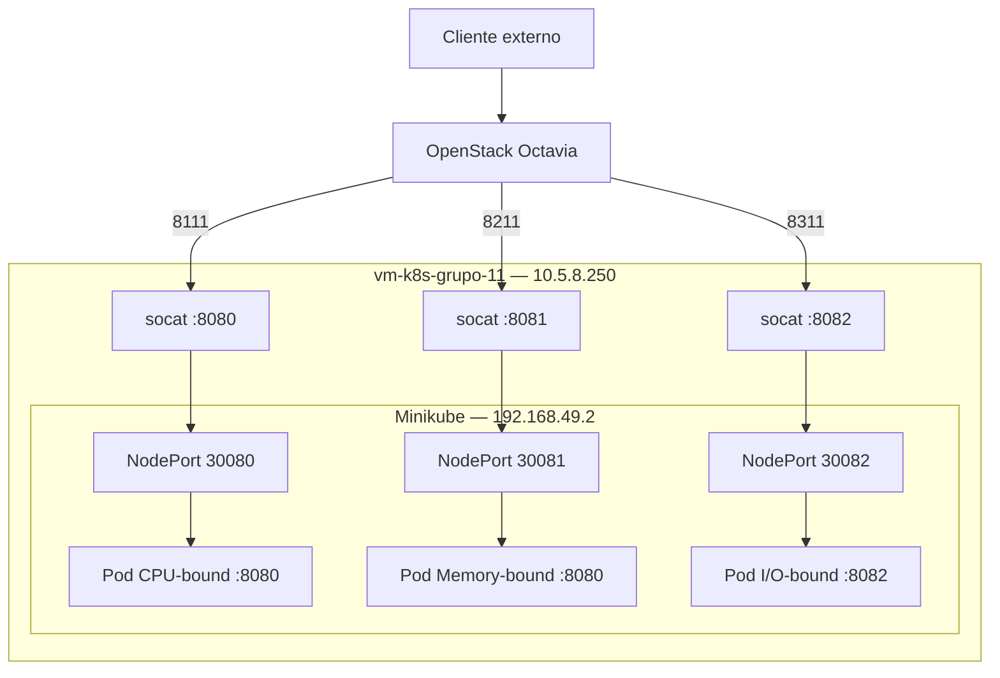

# Atividade 5 — Parte 1: Kubernetes com Minikube

**Disciplina:** Provisionamento e Operação de Infraestruturas — UFCG  
**Grupo:** 11  
**Ambiente:** Cloud OpenStack do LSD/UFCG  
**Data da execução:** 26/11/2026

## 1. Objetivo

Provisionar uma máquina virtual na cloud OpenStack, configurar um cluster Kubernetes de nó único com Minikube e realizar o deploy das aplicações CPU-bound, Memory-bound e I/O-bound desenvolvidas nas atividades anteriores. As aplicações são disponibilizadas remotamente por meio do Load Balancer Octavia já existente, preservando seus listeners e pools.

## 2. Arquitetura



O Minikube utiliza o driver Docker para hospedar o nó Kubernetes em um contêiner, com containerd como runtime do cluster. Como o endereço interno desse nó não é diretamente acessível pelo Octavia na arquitetura utilizada, o socat encaminha as conexões das portas da VM aos NodePorts. Os encaminhamentos são gerenciados pelo systemd.

| Aplicação | Porta externa | Porta da VM | NodePort | Porta do contêiner |
|---|---:|---:|---:|---:|
| CPU-bound | 8111 | 8080 | 30080 | 8080 |
| Memory-bound | 8211 | 8081 | 30081 | 8080 |
| I/O-bound | 8311 | 8082 | 30082 | 8082 |

## 3. Estrutura do repositório

```text
kubernetes/
├── .gitignore
├── README.md
├── k8s/
│   └── apps.yaml
└── scripts/
    ├── install-k8s.sh
    └── forward-ports.sh
```

- `apps.yaml`: Deployments e Services das três aplicações.
- `install-k8s.sh`: alternativa automatizada para reproduzir a instalação manual realizada na atividade.
- `forward-ports.sh`: script utilizado para configurar os encaminhamentos TCP com socat e systemd.
- `.gitignore`: exclusão de arquivos locais e de credenciais do versionamento.

## 4. Provisionamento no OpenStack

### 4.1. Verificação da infraestrutura anterior

Os comandos OpenStack foram executados na máquina `osboxes`, com as credenciais do projeto `Provisionamento` carregadas no shell atual:

```bash
source Provisionamento-openrc.sh
openstack server list
openstack flavor show general.large
openstack limits show --absolute
openstack keypair list
openstack image show ubuntu-24.04
openstack network show provider
openstack security group rule list sg-grupo-11
openstack loadbalancer pool list | grep -E 'grupo-?11'
openstack loadbalancer listener list | grep -E 'grupo-?11'
```

A VM anterior `vm-grupo-11` não foi encontrada na listagem. Os pools, listeners, chave SSH e grupo de segurança existentes foram preservados. Não foi confirmada nesta execução a remoção de volumes ou snapshots antigos.

### 4.2. Configuração da nova VM

| Recurso | Configuração |
|---|---|
| Nome | `vm-k8s-grupo-11` |
| Flavor | `general.large` |
| Imagem | `ubuntu-24.04` |
| Sistema operacional observado | Ubuntu 24.04.3 LTS |
| vCPUs | 4 |
| RAM nominal | 8 GiB (7,8 GiB apresentados pelo sistema) |
| Disco nominal | 20 GB |
| Rede | `provider` |
| IP privado atribuído | `10.5.8.250` |
| Grupos de segurança | `default`, `sg-grupo-11` |
| Par de chaves | `chave-grupo-11` |

Após a disponibilização de cotas de CPU e RAM, a VM foi criada com:

```bash
openstack server create \
  --flavor general.large \
  --image ubuntu-24.04 \
  --key-name chave-grupo-11 \
  --security-group default \
  --security-group sg-grupo-11 \
  --network provider \
  vm-k8s-grupo-11
```

Validação do provisionamento:

```bash
openstack server show vm-k8s-grupo-11 \
  -c name -c status -c addresses -c flavor -c image \
  -c security_groups -c key_name
```

O estado final observado foi `ACTIVE`. Em uma reprodução, verifique se já existe uma VM do grupo antes de criar outra e substitua os endereços IP deste documento pelos efetivamente atribuídos.

### 4.3. Atualização do acesso SSH

O listener SSH existente (porta externa 2211) foi preservado. O membro anterior, que apontava para `10.5.8.45`, foi substituído pelo membro associado à nova VM:

```bash
openstack loadbalancer member create \
  --name member-ssh-k8s-grupo11 \
  --address 10.5.8.250 --protocol-port 22 pool-ssh-grupo-11

openstack loadbalancer member list pool-ssh-grupo-11
```

Após confirmar o novo membro em `ACTIVE`, executou-se:

```bash
openstack loadbalancer member delete pool-ssh-grupo-11 member-ssh-grupo-11
openstack loadbalancer member list pool-ssh-grupo-11
```

A conexão foi realizada a partir da `osboxes`:

```bash
ssh -o ServerAliveInterval=15 -o ServerAliveCountMax=6 \
  -i ~/.ssh/chave-grupo-11.pem -p 2211 ubuntu@150.165.85.77
```

Como a VM foi substituída, a chave de identificação do host mudou. Antes de atualizar o `known_hosts`, a impressão digital ED25519 apresentada pelo SSH foi comparada com a obtida no console do OpenStack:

```bash
openstack console log show vm-k8s-grupo-11 | grep -A 4 'BEGIN SSH HOST KEY FINGERPRINTS'
```

Somente após confirmar a correspondência, removeu-se a entrada antiga:

```bash
ssh-keygen -R '[150.165.85.77]:2211'
```

Na nova VM, verificaram-se os recursos:

```bash
nproc && free -h && df -h /
lsb_release -a
```

## 5. Instalação e configuração do Kubernetes

Os procedimentos desta seção foram executados na VM `vm-k8s-grupo-11` como usuário `ubuntu`. A instalação foi manual; o script `scripts/install-k8s.sh` foi elaborado posteriormente para facilitar sua reprodução.

### 5.1. Dependências

```bash
sudo apt update
sudo apt install -y docker.io socat curl
sudo systemctl enable --now docker
sudo usermod -aG docker ubuntu
newgrp docker
```

Verificação:

```bash
dpkg-query -W docker.io socat curl
groups
systemctl is-active docker
systemctl is-enabled docker
docker ps
```

A inclusão do usuário no grupo Docker permite executar os comandos sem `sudo`. O grupo Docker concede acesso privilegiado ao daemon e deve ser restrito a usuários autorizados.

### 5.2. kubectl e Minikube

```bash
sudo snap install kubectl --classic
kubectl version --client

curl -LO https://storage.googleapis.com/minikube/releases/latest/minikube-linux-amd64
sudo install minikube-linux-amd64 /usr/local/bin/minikube
rm minikube-linux-amd64
minikube version
```

### 5.3. Criação do cluster

```bash
minikube start --driver=docker --cpus=4 --memory=6144
```

Foram destinados 4 vCPUs e 6 GiB de RAM ao nó Kubernetes, preservando parte da memória para o sistema hospedeiro.

| Componente | Versão observada |
|---|---|
| Docker | 29.1.3 |
| socat | 1.8.0.0 |
| curl | 8.5.0 |
| Minikube | 1.39.0 |
| Kubernetes | 1.37.0 |
| containerd | 2.3.4 |
| kubectl inicial (Snap) | 1.35.10 |
| kubectl compatível (Minikube) | 1.37.0 |

### 5.4. Adequação do kubectl

O cliente instalado pelo Snap apresentava duas versões menores de diferença em relação ao servidor. Foi utilizada a versão compatível disponibilizada pelo Minikube:

```bash
minikube kubectl -- version
echo 'alias kubectl="minikube kubectl --"' >> ~/.bashrc
source ~/.bashrc
kubectl version
```

O alias vale para sessões interativas do Bash. Em scripts, utilize explicitamente `minikube kubectl --`.

### 5.5. Validação do cluster

```bash
minikube status
kubectl get nodes
kubectl get pods -A
minikube ip
```

O nó `minikube` apresentou estado `Ready`, os oito Pods de sistema estavam `Running` e sem reinicializações, e o IP interno observado foi `192.168.49.2`.

### 5.6. Alternativa automatizada

Em uma VM Ubuntu nova, com acesso à internet, sudo e recursos suficientes, pode-se utilizar:

```bash
chmod +x scripts/install-k8s.sh
./scripts/install-k8s.sh
```

O script fixa as versões do Minikube e do Kubernetes observadas na atividade. Depois de executá-lo, abra uma nova sessão para aplicar a associação ao grupo Docker e o alias do kubectl. Esta alternativa foi preparada após a instalação manual e não foi testada integralmente em uma VM limpa. Não é necessário executá-la novamente na infraestrutura já configurada.

## 6. Deploy das aplicações

Na VM Kubernetes, foi clonado o repositório do grupo:

```bash
git clone git@github.com:poi-ufcg-2026-2/kubernetes.git
cd kubernetes
kubectl apply -f k8s/apps.yaml
kubectl get pods -w
```

A clonagem via SSH requer uma chave autorizada no GitHub. Não copie chaves privadas para o repositório.

Após os Pods atingirem `Running` e `Ready 1/1`, encerrou-se apenas o monitoramento com `Ctrl+C` e verificaram-se os recursos:

```bash
kubectl get pods,deploy,svc
```

### 6.1. Imagens utilizadas

| Aplicação | Imagem Docker |
|---|---|
| CPU-bound | `rayanne9/image-restoration:1.0` |
| Memory-bound | `csabrina/ramdex-api:1.0` |
| I/O-bound | `marciathais/bytesum-api:1.0` |

### 6.2. Recursos configurados

| Aplicação | Réplicas | CPU request | CPU limit | Memória request | Memória limit |
|---|---:|---:|---:|---:|---:|
| CPU-bound | 1 | 500m | 1 | 256Mi | 512Mi |
| Memory-bound | 1 | 250m | Não definido | 600Mi | 800Mi |
| I/O-bound | 1 | 100m | Não definido | 128Mi | 256Mi |

### 6.3. Justificativas técnicas

- **Deployment:** gerencia o ciclo de vida dos Pods, mantendo a quantidade desejada de réplicas e permitindo sua recriação em caso de falha. As aplicações não exigem identidade estável de Pod nem armazenamento persistente nesta etapa, de modo que não foi adotado StatefulSet.
- **Uma réplica por aplicação:** simplifica o ambiente de nó único e o consumo de recursos. A aplicação Memory-bound mantém dados em memória, portanto múltiplas réplicas independentes poderiam apresentar estados divergentes.
- **Requests e limits:** os requests orientam o escalonamento dos Pods; os limits delimitam o consumo dos recursos configurados. Os limites de memória preservam o isolamento dos workloads. A CPU-bound possui também limite explícito de CPU.
- **NodePort:** disponibiliza uma porta estável no nó Kubernetes para cada aplicação, permitindo o encaminhamento através da VM e o reaproveitamento do Load Balancer.
- **Readiness probes:** verificam a prontidão dos contêineres antes que os Services lhes encaminhem tráfego. São utilizadas sondagens TCP nas aplicações CPU-bound e Memory-bound e HTTP (`/health`) na I/O-bound.
- **Volumes emptyDir:** disponibilizam o diretório `/logs` durante a vida do Pod. Os dados não persistem quando o Pod é removido.

Os três Deployments apresentaram uma réplica disponível, os três Pods estavam prontos e em execução, sem reinicializações, e os Services NodePort foram criados conforme o manifesto.

## 7. Encaminhamento de portas

Na VM, executou-se o script:

```bash
./scripts/forward-ports.sh
```

O script identifica o IP do Minikube e cria os serviços systemd `k8s-forward-cpu`, `k8s-forward-memory` e `k8s-forward-io`. Cada serviço executa o socat para encaminhar conexões da porta da VM ao NodePort correspondente.

Validação:

```bash
systemctl list-units 'k8s-forward-*' --no-pager
sudo ss -ltnp | grep -E '808[012]'

curl -sS -o /dev/null -w 'CPU-bound: HTTP %{http_code}\n' --max-time 10 http://127.0.0.1:8080/
curl -sS -o /dev/null -w 'Memory-bound: HTTP %{http_code}\n' --max-time 10 http://127.0.0.1:8081/
curl -sS -o /dev/null -w 'IO-bound: HTTP %{http_code}\n' --max-time 10 http://127.0.0.1:8082/health
```

Os três serviços estavam ativos, as portas em escuta e os testes retornaram HTTP 200.

## 8. Integração com o Load Balancer

Na `osboxes`, os membros dos pools das aplicações foram atualizados individualmente, preservando os listeners e os pools existentes. O endereço anterior era `10.5.8.45` e o novo endereço é `10.5.8.250`.

```bash
openstack loadbalancer member create --name member-cpu-k8s-grupo11 \
  --address 10.5.8.250 --protocol-port 8080 pool-cpu-grupo11
openstack loadbalancer member list pool-cpu-grupo11
# Apos o novo membro atingir ACTIVE:
openstack loadbalancer member delete pool-cpu-grupo11 member-cpu-grupo11
openstack loadbalancer member list pool-cpu-grupo11
```

```bash
openstack loadbalancer member create --name member-memory-k8s-grupo11 \
  --address 10.5.8.250 --protocol-port 8081 pool-memory-grupo11
openstack loadbalancer member list pool-memory-grupo11
# Apos o novo membro atingir ACTIVE:
openstack loadbalancer member delete pool-memory-grupo11 member-memory-grupo11
openstack loadbalancer member list pool-memory-grupo11
```

```bash
openstack loadbalancer member create --name member-io-k8s-grupo11 \
  --address 10.5.8.250 --protocol-port 8082 pool-io-grupo11
openstack loadbalancer member list pool-io-grupo11
# Apos o novo membro atingir ACTIVE:
openstack loadbalancer member delete pool-io-grupo11 member-io-grupo11
openstack loadbalancer member list pool-io-grupo11
```

A remoção de cada membro antigo foi confirmada antes da próxima alteração. O estado `ACTIVE` confirma o provisionamento dos membros, não sua saúde operacional, pois os pools não possuem Health Monitor configurado.

## 9. Dificuldades encontradas e soluções

| Problema | Solução ou encaminhamento |
|---|---|
| Falha de autenticação OpenStack (`401`) | Novo arquivo OpenRC obtido pelo Horizon e carregado com `source`. |
| Cotas de CPU e RAM esgotadas (`403`) | Registrou-se a indisponibilidade (96/96 vCPUs e 192/192 GiB de RAM); a criação foi retomada quando o OpenStack aceitou a solicitação. |
| Load Balancer temporariamente imutável (`409`) | Consultou-se o estado de provisionamento e repetiu-se a operação quando estava `ACTIVE`. |
| Mudança da chave de identificação SSH | Validou-se o fingerprint no console OpenStack antes de atualizar o `known_hosts`. |
| Desconexões SSH | Reconexão e adoção de `ServerAliveInterval` para reduzir interrupções por inatividade. |
| Diferença de versões do kubectl | Utilização do cliente compatível disponibilizado pelo Minikube. |
| Timeout externo da aplicação CPU-bound | Diagnóstico de conectividade e inclusão de regra restrita no grupo de segurança do grupo. |

### 9.1. Diagnóstico do timeout da CPU-bound

Inicialmente, Memory-bound e I/O-bound retornaram HTTP 200 externamente, enquanto CPU-bound apresentou timeout (HTTP 000 no curl). Os listeners e pools foram comparados, sem diferenças relevantes nos campos consultados. Os testes locais na CPU-bound retornaram HTTP 200 no NodePort, na porta encaminhada pelo socat e no IP privado da VM.

Na VM, a captura comparativa foi realizada com:

```bash
sudo tcpdump -ni any 'tcp port 8080 or tcp port 8081'
```

Durante os testes externos, foram observados pacotes destinados à porta 8081, provenientes de `10.5.11.192`, e nenhum pacote destinado à porta 8080. A análise dos grupos de segurança mostrou que `sg-grupo-11` permitia originalmente as portas das aplicações a partir de `10.5.11.10/32`, enquanto o grupo `default` possuía permissões amplas para 8081 e 8082, mas não uma regra TCP equivalente para 8080.

Na `osboxes`, adicionou-se uma regra específica ao grupo `sg-grupo-11`:

```bash
openstack security group rule create \
  --ingress --protocol tcp --dst-port 8080 \
  --remote-ip 10.5.11.192/32 sg-grupo-11
```

O acesso externo à CPU-bound passou a retornar HTTP 200. O grupo `default` compartilhado não foi alterado. Em uma reprodução, confirme o endereço de origem atual do balanceador antes de aplicar a regra; não amplie indiscriminadamente as permissões de entrada.

## 10. Validação do acesso externo

Na `osboxes`, após a correção das regras de segurança:

```bash
curl -sS -o /dev/null -w 'CPU-bound: HTTP %{http_code}\n' --max-time 15 http://150.165.85.77:8111/
curl -sS -o /dev/null -w 'Memory-bound: HTTP %{http_code}\n' --max-time 15 http://150.165.85.77:8211/
curl -sS -o /dev/null -w 'IO-bound: HTTP %{http_code}\n' --max-time 15 http://150.165.85.77:8311/health
```

| Aplicação | Endpoint testado | Resultado observado |
|---|---|---|
| CPU-bound | `http://150.165.85.77:8111/` | HTTP 200 |
| Memory-bound | `http://150.165.85.77:8211/` | HTTP 200 |
| I/O-bound | `http://150.165.85.77:8311/health` | HTTP 200 |

Os resultados validam a disponibilidade HTTP e a conectividade externa das três aplicações pela infraestrutura provisionada. Não foram realizados testes funcionais completos das operações de negócio, nem testes de carga ou de desempenho nesta execução.

## 11. Considerações finais

A infraestrutura foi provisionada com sucesso, com o reaproveitamento dos recursos de balanceamento das atividades anteriores. O cluster Kubernetes foi validado, as três aplicações foram implantadas e o acesso externo foi confirmado após a adequação das regras de segurança.

Pontos de atenção para manutenção e reprodução:

- O cluster tem apenas um nó e uma réplica por aplicação; não oferece alta disponibilidade.
- O disco nominal de 20 GB é inferior aos 30 GB recomendados pelo guia; monitore o espaço com `df -h /`.
- Após reiniciar a VM, verifique `minikube status` e, se necessário, execute `minikube start`. Os serviços de socat são habilitados no systemd, mas não inicializam o cluster por conta própria.
- Caso o IP interno do Minikube mude, execute novamente `scripts/forward-ports.sh`.
- Os endereços IP e as permissões do OpenStack podem mudar; valide-os antes de reproduzir os comandos.
- As capturas de tela da execução são mantidas separadamente no documento da atividade. Não publique senhas, tokens, arquivos OpenRC nem chaves privadas.
